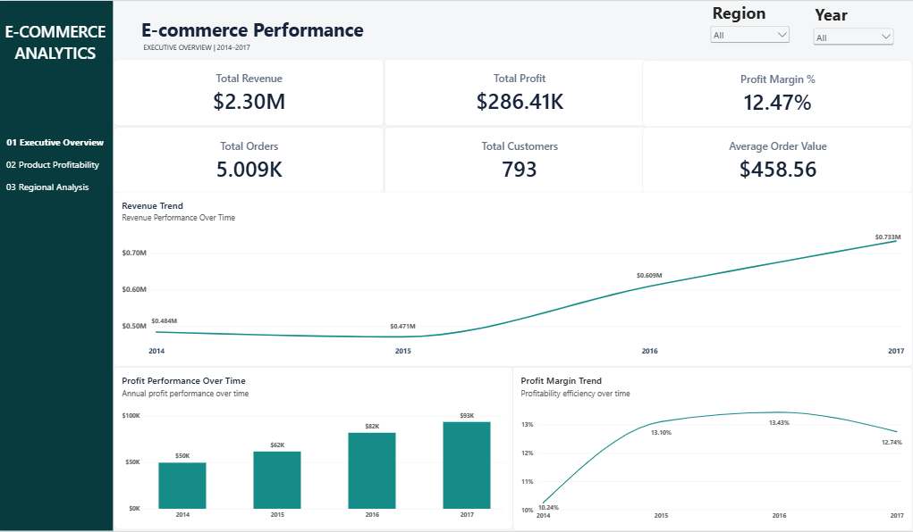
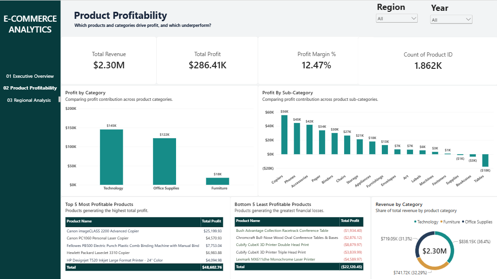
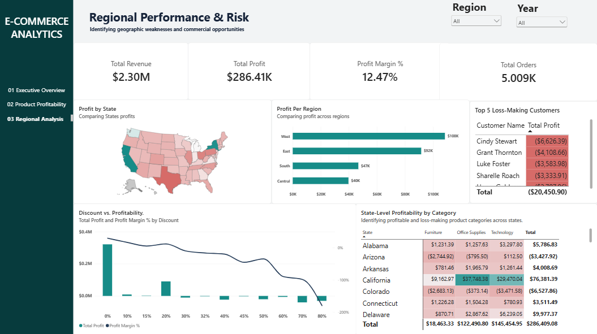

# E-commerce Profitability & Revenue Intelligence

An end-to-end data analytics project using **MySQL and Power BI** to investigate sales performance, profitability, product trends, customer behavior, and regional performance.

## Project Overview

This project analyzes the Sample Superstore dataset to identify revenue drivers, profitability issues, and business opportunities. SQL was used for data cleaning and exploratory analysis, while Power BI was used to build an interactive three-page dashboard.

## Tools & Technologies

- **MySQL:** Data cleaning, transformation, and exploratory data analysis
- **Power BI:** Data modeling and interactive dashboard development
- **DAX:** Measures, KPIs, and year-over-year revenue growth

## Dataset

The project uses the Sample Superstore dataset, containing order-level sales information.

- Raw dataset: `data/RAW/Sample - Superstore.csv`
- Cleaned dataset: `data/clean/orders_final_export.tsv`
- Final cleaned records: **9,993**

Data preparation included duplicate removal, handling missing and blank values, standardizing fields, validating dates and numeric values, and converting columns to appropriate data types.

## Dashboard

The Power BI report contains three pages:

### 1. Executive Overview



Provides an overview of revenue, profit, profit margin, orders, customers, and average order value, with performance trends from 2014 to 2017.

### 2. Product Profitability



Examines category and subcategory profitability, highlights the most and least profitable products, and compares revenue contribution across categories.

### 3. Regional Performance & Risk



Explores state-level profitability, regional performance, discount patterns, and loss-making customers.

## Key Business Findings

- Total revenue reached **$2.30 million**, with total profit of **$286,409**.
- Overall profit margin was **12.47%**.
- Technology generated the highest category profit, while Furniture had a much lower profit margin of **2.49%**.
- The West region recorded the highest revenue and profit.
- Central had the lowest regional profit margin at **7.92%**.
- Discount levels of 30% and above showed negative aggregate profit in this dataset.
- The Tables and Bookcases subcategories recorded overall losses.

## Repository Structure

```text
Ecommerce-Profitability-Analysis/
│
├── data/
│   ├── RAW/
│   └── clean/
│
├── SQL/
│   ├── DATA_CLEANING_sql.sql
│   └── exploratory_analysis.sql
│
├── Power BI/
│   └── Ecommerce_Profitability.pbix
│
├── Screenshots/
│   ├── executive-overview.png
│   ├── product-profitability.png
│   └── regional-performance.png
│
└── README.md
```

## Files

- SQL scripts: data cleaning and exploratory analysis queries.
- Power BI file: interactive dashboard report.
- Screenshots: dashboard page previews.
- Data folder: original and cleaned datasets.

---

**Project focus:** SQL · Data Cleaning · Exploratory Data Analysis · Power BI · DAX · Business Intelligence
